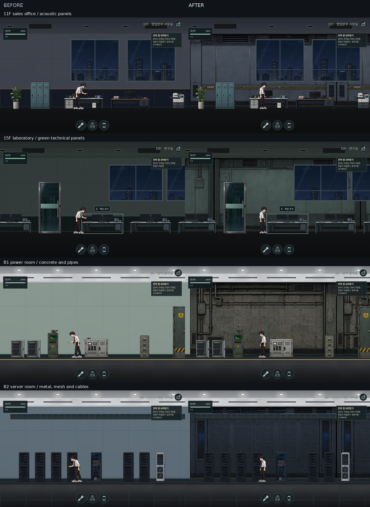

# 미완성 배경 보완 · 2026-10-17

단색 임시 벽이 남아 있던 방 19곳과 복도 15곳에 새로 제작한 배경 그림을 적용했다. 사무실 패널·연구실 패널·콘크리트와 배관·서버실 금속과 케이블의 네 가지 마감을 사용한다.

| 위치 | 적용한 방 |
| --- | --- |
| 11F | 영업본부 사무실, 전략회의실, 마케팅 자료실 |
| 13F | 기술지원 상황실, 장비 검증실, 보안 자료실, 고객 교육장 |
| 14F | 연구 자료실, 데이터 연구실, 사용자 실험실 |
| 15F | 연구실, 세미나실, 연구본부장실 |
| 17F | 관리자실 |
| B1 | 시설관리팀 사무실, 전력 분배실 |
| B2 | ARCHI 메인 서버실, 전력·냉각실, 연결 실험실 |

복도는 B2·B1·2·3·4·5·6·8·9·10·11·13·14·15·16층의 미완성 벽 구간을 마감했다. 이미 완성된 배경 그림은 유지했다. 기존 외창·유리 전면·관찰창·모니터와 15층 본부장실의 하단 목재 마감이 보이도록 배경을 잘라 적용한다. 새 배경은 문·소품 뒤에 그려지며 충돌과 조사 좌표에는 관여하지 않는다.

검증:

- 1440×900 플레이어 카메라로 변경된 34개 장면의 전체 너비를 137개 화면으로 촬영·확인했다. 1920×1080 주요 장면, 정전과 플래시, 2560×1080 연구실 화면도 확인했다.
- `tests/painted-backgrounds.mjs`: 34개 장면의 실제 배경 표시, 아틀라스 비율, 복도 유리 배치, 외창·유리·모니터 보존 검사 통과.
- `tests/visual-layout.mjs`: 94개 장면의 스프라이트 비율·바닥 정렬·문 가림·가구 겹침 및 외창 26곳의 전력 독립성 검사 통과.
- `tests/scene-assets.mjs`: 95개 장면과 CSS 이미지 60개 로드 검사 통과.
- `tests/building-finishes.mjs`: 94개 장면의 천장·벽·바닥 전체 범위 확인 통과. `npm run test:syntax`의 스크립트 89개와 `git diff --check` 통과.

이 환경에서는 Chromium의 `file://` 접근이 차단되어 동일 파일을 로컬 HTTP 서버로 제공했다. 원본 그림과 적용 위치는 `assets/background/painted-walls/GENERATED.md`와 `js/floors/background-art.js`에 기록했다. 전체 게임 회귀 테스트와 원격 배포는 하지 않았다.
