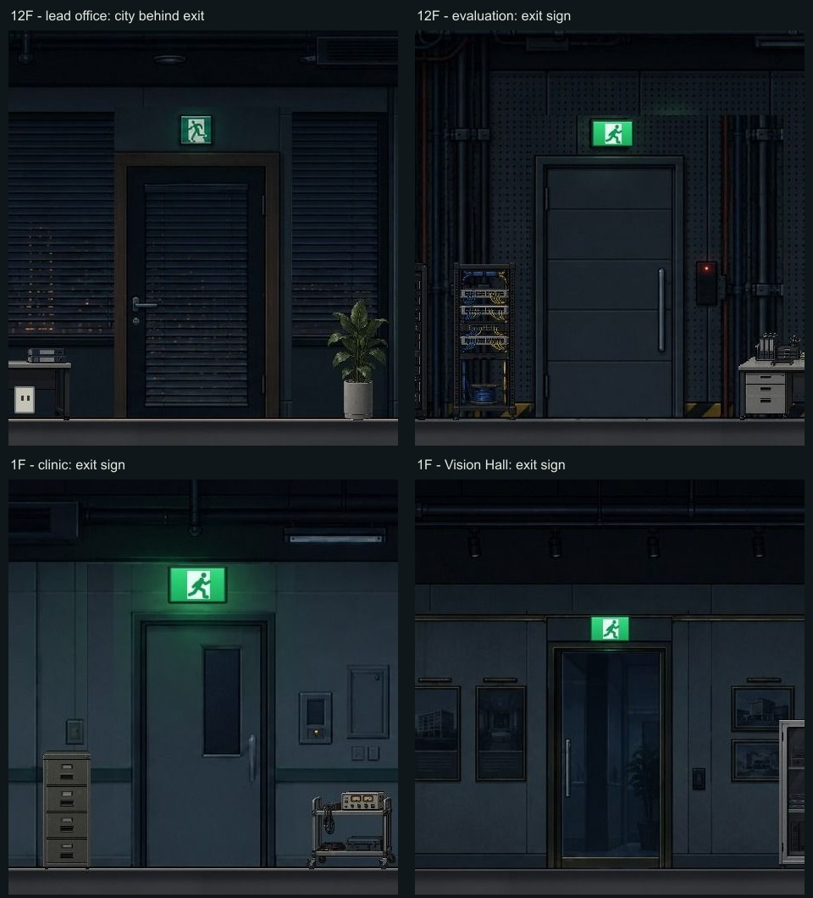

# 전 층 배경 이미지 점검 · 2026-10-18

> 후속 수정 완료: 아래에서 지적한 12층 팀장실·모델 평가실·1층 건강관리실·Vision Hall의 일반 출입문을 수정했다. 팀장실 문 너머는 실내 복도로 바꾸고 네 곳의 비상구 표지를 제거했다. 아래 점검 사진은 수정 전 기록이다. [팀장실 수정 후](previews/room-exit-fixed/f12-lead-on.png) · [평가실 수정 후](previews/room-exit-fixed/f12-eval-on.png) · [건강관리실 수정 후](previews/room-exit-fixed/f1-clinic-on.png) · [Vision Hall 수정 후](previews/room-exit-fixed/f1-vision-on.png). 원본 이미지와 게임용 마감본을 함께 수정했으며 프롬프트·영역·최종 조각은 [생성 기록](../assets/background/room-exit-fixes/PROMPTS.md)에 있다.

B2·B1·1~17층·옥상의 96개 장면을 확인했다. 17층 초기 사무실과 복도는 별도 장면으로 포함했다. 전체 폭을 플레이어 카메라 크기로 나누어 245개 화면을 촬영했고, 방 내부 복도 출입문 74곳을 따로 확대했다. 아래는 이미지 내용과 실제 문 목적지를 대조한 결과다. 게임 코드와 배경 이미지는 이번 조사에서 수정하지 않았다.

## 우선 수정할 문제

### 12층 팀장실: 복도 출입문 너머에도 블라인드와 야경이 이어진다

- 장면: `f12-lead`. 실제 문 목적지는 `f12` 복도다.
- 문 안쪽 유리에 주변 외창과 같은 블라인드·도시 불빛이 들어 있다. 문 위에는 비상구 그림도 남아 있다. 앞서 고친 개발실과 같은 종류의 문제다.
- [실제 게임 화면](previews/background-audit/finding-f12-lead.png)
- 그림: `assets/background/floor12/lead.png`, `lead-finished.png`. 문 설정: `js/floors/floor-12.js`의 `f12-lead`.
- 문은 원본의 `[1800, 200, 210, 370]` 영역을 `exitArt`로 옮겨 표시한다. 수정 시 이 영역의 문 너머를 실내 복도로 바꾸고 표지를 제거해야 한다. 문 위치·출입 판정 변경은 필요하지 않다.

## 개발실과 같은 기준으로 정리할 표지

아래 세 문은 실제로 일반 층 복도로 연결된다. 비상구 그림이 있는 것은 화면에서 확인했지만, 건물의 피난 경로를 안내하는 표지로도 해석할 수 있다. 따라서 문 너머 야경 오류와 구분해 **사용자가 정한 일반 출입문 표기 기준에 맞출 대상**으로 기록한다.

| 위치 | 확인한 내용 | 근거 |
| --- | --- | --- |
| 12층 모델 평가실 (`f12-eval`) | 복도 출입문 위에 녹색 비상구 표지가 있다. 배경 그림과 별도 발광 표지 설정 모두 확인했다. | [게임 화면](previews/background-audit/finding-f12-eval.png) |
| 1층 건강관리실 (`f1-clinic`) | 복도 출입문 위에 큰 비상구 표지가 있다. 배경 그림과 발광 표지가 함께 적용된다. | [게임 화면](previews/background-audit/finding-f1-clinic.png) |
| 1층 Vision Hall (`f1-vision`) | 복도로 연결되는 유리문 위에 비상구 표지가 있다. 문 너머는 실내로 보여 야경 오류는 확인되지 않았다. | [게임 화면](previews/background-audit/finding-f1-vision.png) |

배경은 각각 `assets/background/floor12/eval-finished.png`, `assets/background/floor1/clinic-finished.png`, `assets/background/floor1/vision-finished.png`다. 별도 표지는 `js/world/background-power.js`의 `luminousSigns`에서 추가한다. 그림만 고치면 녹색 표지가 다시 겹칠 수 있다.

1층 Harmony Hall에는 패닉바가 달린 양개문 위 비상구 표지가 있다. 공연장 대피문으로 자연스럽게 보이므로 확정 오류로 분류하지 않았다. 2~10층 일부 벽의 화살표형 유도 표지도 문 위 표지와 구분했다. 방향 안내 표지는 문과 떨어져 있다는 이유만으로 잘못된 이미지라고 단정하지 않았다.

## 층별 확인 기록

‘추가 이상 없음’은 이번 화면 검토와 아래 자동 검사에서 다른 명확한 결함을 발견하지 못했다는 뜻이다.

| 층 | 결과 | 전체 장면 모음 |
| --- | --- | --- |
| B2 | 복도·메인 서버실·전력냉각실·연결 실험실·화장실: 추가 이상 없음 | [보기](previews/background-audit/sheet--2.jpg) |
| B1 | 복도·시설관리실·방재 관제실·전력 분배실·화장실: 추가 이상 없음. 관제실의 어두운 경보 조명은 의도된 상태 | [보기](previews/background-audit/sheet--1.jpg) |
| 1 | 건강관리실·Vision Hall 표지 검토. 그 밖의 명확한 결함 없음 | [보기](previews/background-audit/sheet-1.jpg) |
| 2 | 추가 이상 없음 | [보기](previews/background-audit/sheet-2.jpg) |
| 3 | 추가 이상 없음 | [보기](previews/background-audit/sheet-3.jpg) |
| 4 | 추가 이상 없음 | [보기](previews/background-audit/sheet-4.jpg) |
| 5 | 추가 이상 없음 | [보기](previews/background-audit/sheet-5.jpg) |
| 6 | 추가 이상 없음 | [보기](previews/background-audit/sheet-6.jpg) |
| 7 | 추가 이상 없음 | [보기](previews/background-audit/sheet-7.jpg) |
| 8 | 추가 이상 없음 | [보기](previews/background-audit/sheet-8.jpg) |
| 9 | 추가 이상 없음 | [보기](previews/background-audit/sheet-9.jpg) |
| 10 | 추가 이상 없음 | [보기](previews/background-audit/sheet-10.jpg) |
| 11 | 추가 이상 없음 | [보기](previews/background-audit/sheet-11.jpg) |
| 12 | 팀장실 문 너머 야경·표지, 평가실 표지 확인. 수정된 개발실 문은 정상 | [보기](previews/background-audit/sheet-12.jpg) |
| 13 | 추가 이상 없음. 보안 자료실은 검증실과 연결된 안쪽 방이므로 별도 복도 출구가 없는 구성이 정상 | [보기](previews/background-audit/sheet-13.jpg) |
| 14 | 자료실 암전은 `dark` / `f14-archive-lamp`에 따른 의도된 상태. 작업등을 켠 상태에서도 배경 확인 | [전체](previews/background-audit/sheet-14.jpg) · [작업등 켬](previews/background-audit/f14-archive-lit.jpg) |
| 15 | 추가 이상 없음 | [보기](previews/background-audit/sheet-15.jpg) |
| 16 | 추가 이상 없음 | [보기](previews/background-audit/sheet-16.jpg) |
| 17 | 초기 사무실·복도·화장실·관리자실 확인. 추가 이상 없음 | [전체](previews/background-audit/sheet-17.jpg) · [관리자실](previews/background-audit/f17-manager.jpg) |
| 옥상 | 추가 이상 없음 | [보기](previews/background-audit/sheet-18.jpg) |

## 검사와 범위

- `tests/visual-layout.mjs` 통과: 94개 장면의 스프라이트 비율·바닥 정렬·가구와 문 간섭, 외창 26곳의 배치와 전력 독립성.
- `tests/scene-assets.mjs` 통과: 장면 95개와 CSS 이미지 55개의 로드, 스크립트 구문.
- `tests/background-power.mjs` 통과: 조명 교체 배경 13종, 94개 장면의 전원 상태·작업등·플래시·배치와 모바일 검사.
- `tests/building-finishes.mjs` 통과: 배경 높이 0~760 전체 범위와 마감 이미지 29종.
- 전경 UI와 플레이어를 숨긴 사진은 배경 검토용이다. 주요 문제 네 곳은 UI가 표시된 실제 게임 화면도 별도로 남겼다. 전체 촬영 목록은 [manifest.json](previews/background-audit/manifest.json)에 있다.
- 좁은 17층 관리자실의 화면 중앙 여백은 배경 결함이 아니다. 별도 촬영한 `f17-manager.jpg`는 그 여백을 제외한 방 전체다.
- 전체 스토리 진행·모든 컷씬·문 개폐의 모든 순간·실제 모바일 기기까지 검사한 것은 아니다. 자동 검사 통과가 배경 내용의 자연스러움까지 보장하지는 않는다.
