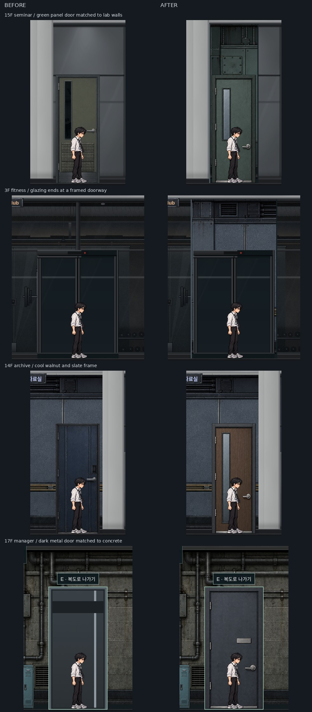

# 방문 종류와 출입구 구조 수정 · 2026-10-17

문 주변 152개 PC 화면을 다시 점검했다. 일반 방의 문은 용도에 맞게 바꾸고, 유리벽 위에 문 그림만 붙어 보이던 출입구를 벽과 문틀로 구분했다.

| 위치 | 수정 |
| --- | --- |
| 3F Studio | 경고등이 달린 설비실 문 대신 어두운 흡음벽에 맞춘 청회색 금속문 |
| 13F 고객 교육장 | 회색 패널 벽과 어울리는 짙은 목재·슬레이트 문틀, 복도·내부 동일 적용 |
| 14F 연구 자료실 | 보안 설비용 외형 대신 목재 방문과 슬레이트 문틀, 복도·내부 동일 적용 |
| 15F 세미나실 | 하단 통풍판이 달린 설비문 대신 연구실 벽에 맞춘 녹색 패널 방문, 복도·내부 동일 적용 |
| 17F 관리자실 내부 | 검은 띠만 있던 임시 CSS 문 대신 콘크리트·배관에 어울리는 짙은 금속문 |
| B1 시설관리팀 사무실 | 청회색 사무실 레버 문, 복도·내부 동일 적용 |
| 13F 장비 검증실 ↔ 보안 자료실 | 임시 CSS 연결문 양쪽을 배관·설비 배경에 맞는 금속문으로 통일 |

유리 전면의 복도 문과 기존 실내 출구 구역 53곳에 월드 y=100..570을 잇는 벽 구간을 추가했다. 창틀과 유리가 문 위·양옆으로 이어지지 않고 출입구에서 끊어진다. 문설주는 문틀 양옆 8px에 두며, 바닥·천장과 연결한다. 기존 외창 26곳에는 겹치지 않는다.

기존 벽 아틀라스와 사무실 문을 화풍·색상 참고로 사용해 목재·녹색 패널·청회색 금속 방문 3종을 새로 제작했다. 비상문 가로 밀대·경고등·위험 표지·화장실 표지는 넣지 않았다. PNG의 바깥 투명 여백은 CSS로 제외해 문틀 하단을 바닥에 맞췄다. 제작 기록은 `assets/objects/room-doors/GENERATED.md`에 있다. 실제 비상계단, 보안실·서버실·전력실, CU 셔터의 잠금과 퍼즐은 유지한다.

검증 로그와 전체 화면은 `.local/door-design/`에 보관한다. 1440×900 문 주변 전체, 1920×1080 주요 장면 및 정전·손전등, 2560×1080 화면을 확인했다. `door-architecture.mjs`는 94개 장면에서 53개 벽 구간·일반 방문 11면·연결문 2면·외창 분리·문 상부 차광 검사를 통과했다. 기존 배치·문 개폐·벽 마스킹·키보드 출입·15/16층 퍼즐·95개 장면 에셋 로드 검사와 JavaScript 문법 검사도 통과했다. 최종 PC 화면 캡처 중 브라우저 오류는 없었다.

전체 게임 회귀 테스트와 커밋·원격 푸시·배포는 하지 않았다.
