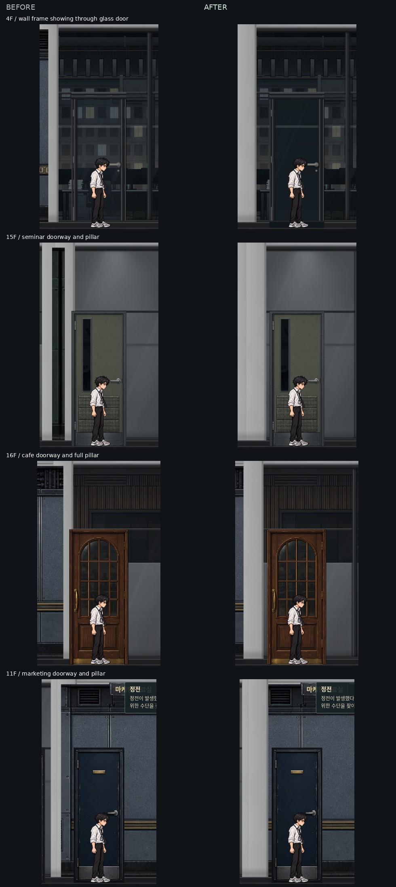

# 문·창문·벽 겹침 수정 · 2026-10-17

전 층 복도와 방 안의 문 주변 152개 PC 화면을 점검했다. 문과 기둥의 실제 겹침 8곳, 여유 공간이 6px뿐인 시설관리실 문, 반투명 유리문 뒤로 벽 프레임이 비치는 문제를 수정했다.

| 위치 | 복도 문 x 좌표 |
| --- | --- |
| B2 메인 서버실 | 900 → 888 |
| B1 시설관리팀 사무실 | 4320 → 4322 |
| 11F 마케팅 자료실 | 4668 → 4684 |
| 13F 장비 검증실 | 4300 → 4322 |
| 13F 고객 교육장 | 4800 → 4788 |
| 14F 연구 자료실 | 400 → 382 |
| 15F 세미나실 | 970 → 986 |
| 16F CU 편의점 | 1560 → 1542 |
| 16F 카페 | 4336 → 4354 |

문틀과 기둥 사이에는 최소 8px을 확보했다. 방 안쪽 출구도 기존 좌우 벽 비율 계산을 따라 이동하며, 브로슈어 진열장·서류함·UPS·작업등·화분을 조정해 이동한 출구 앞을 비웠다.

새 벽 그림이 유리 전면 양끝 기둥의 절반을 덮던 문제는 48px 기둥 전체를 보존하도록 수정했다. 외창·관찰창·모니터·기둥·실제 문 개구부를 벽에서 차례로 빼므로, 구멍끼리 겹쳐도 벽이 다시 채워지지 않는다. 반투명 문에는 어두운 개구부 바탕을 적용해 뒤쪽 벽 줄눈·창틀이 문 안으로 비치지 않게 했다.

검증 결과는 `.local/overlap-audit/`에 보관한다. 1440×900 문 주변 수정 전후 화면, 1920×1080 주요 장면과 정전·손전등, 2560×1080 화면을 확인했다. 관련 검사 통과:

- `painted-backgrounds.mjs`: 34개 장면의 벽·문·외창·유리·기둥 경계와 겹친 개구부를 격자로 검사. 원래 창문·모니터 픽셀 보존 확인.
- `door-backdrops.mjs`: 방 안팎 유리문의 열림·닫힘 6개 상태에서 뒤쪽 벽 색을 바꿔도 문 안으로 비치지 않는지 확인. 수정 전 투명 바탕을 임시로 복원하면 검사가 실패하는 것도 확인.
- `visual-layout.mjs`: 94개 장면의 소품·문·외창 겹침, 배율·바닥 정렬, 외창 전력 동작 확인.
- `room-spatial-layout.mjs`의 PC 경로: 방 전면 75곳의 문 비율, 기존 18회 왕복과 변경한 문 9곳을 포함한 추가 11회 키보드 왕복 확인.
- `floor15-art.mjs`, `floor16-art.mjs`: 연구실 점프 경로, 식당·CU 연결문과 셔터 퍼즐 확인.
- `scene-assets.mjs`: 95개 장면과 CSS 이미지 60개 로드 확인. 스크립트 구문과 `git diff --check` 통과.

전체 게임 회귀 테스트와 원격 배포는 하지 않았다.
