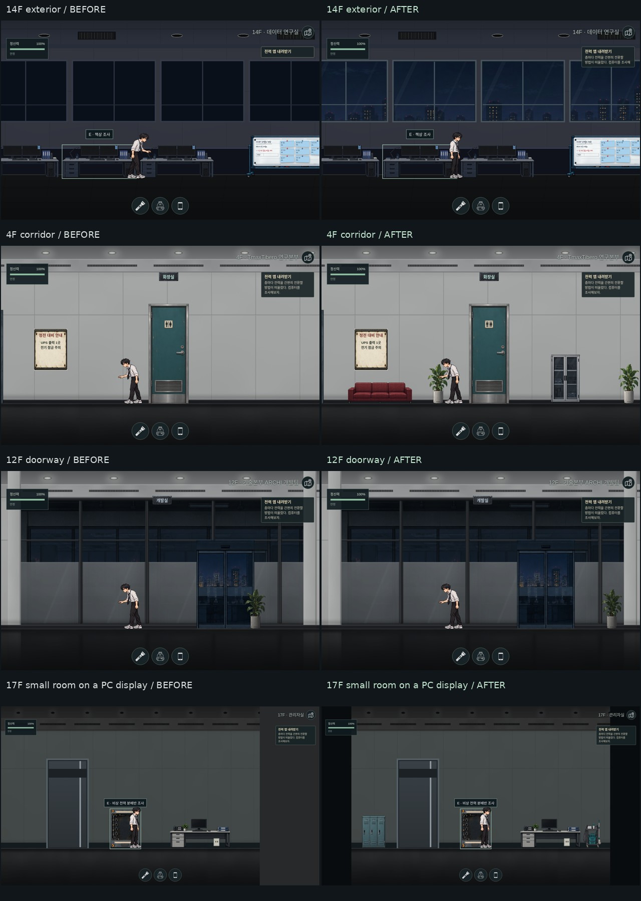

# PC 전 층 시각 점검 · 2026-10-17

B2~17F와 옥상의 복도·방·화장실, 시작 사무실을 포함한 96개 장면을 플레이어 카메라 배율로 점검했다. 수정 전후 각각 322개 화면을 촬영했으며, 1920×1080과 2560×1080에서도 주요 수정 장면과 정전·플래시 시야를 확인했다.

| 확인한 문제 | 반영한 수정 |
| --- | --- |
| 11·13·14·15층의 외창이 단색이라 주변 층의 야경과 연결되지 않음 | 26개 외창에 기존 옥상 야경을 재사용. 층 높이에 따라 세로 위치를 조정하고 유리 반사·창틀·블라인드를 유지. 건물 내부 전력과 외부 도시 불빛을 분리. |
| 12층 개발실 문 테두리 위에 화분이 겹침 | 화분 중심 x=920→1050. 문 그림·테두리·출입 범위를 확보. |
| 2층 직원 휴게실의 문 좌우 공간 비율이 안팎에서 다름 | 복도 문 x=1580→1544. 내부 그림에 맞춘 출구는 유지. |
| 여러 복도의 화장실 옆 벽과 일부 방이 너무 비어 보임 | 좌석·화분·진열장·보관함·청소 카트·연구 장비 등 기존 소품 50개 추가. 기술실 4곳에는 벽 배선 트레이 배치. |
| 15층 세미나실 테이블이 공간에 비해 작음 | 폭 356→420. GPU 포장 상자의 충돌체와 점프 경로는 유지. |
| PC의 넓은 화면에서 작은 방 오른쪽에 회색 빈 영역이 생김 | 방이 화면보다 작으면 가로 중앙에 표시하고 여백 색상을 통일. 월드 크기·스프라이트 배율·충돌 좌표는 유지. |

관찰 유리, 완전히 닫힌 차광창, 창 없는 방에는 야경을 덧씌우지 않았다. 새 소품은 기존 장식 소품처럼 충돌이나 조사 대상을 추가하지 않는다.

검증 결과:

- `tests/visual-layout.mjs`: 94개 동적 장면의 원본 스프라이트 비율, 바닥 정렬, 벽 경계, 문 가림, 가구 겹침, 외창 26곳의 전력 독립성 통과. 1920×1080·2560×1080에서 작은 방 중앙 정렬과 배율 보존 통과.
- `tests/object-layout.mjs`의 PC 경로: 1280×720·1920×1080에서 46회 출입, 단서 가시성, 출구 앞 여유 공간 통과.
- `tests/room-spatial-layout.mjs`의 PC 경로: 방 전면 75곳, 문·그림·테두리 정렬, 18회 키보드 왕복 통과. 12층 평가실의 명시된 문 비율 예외를 검사에도 반영했다.
- `tests/floor02-lounge.mjs`: 가구·리모컨·재입장·저장 복원·영사기 퍼즐 통과.
- `tests/floor15-art.mjs`: 소품 배율·바닥 접촉·출입·단서·상자 충돌·점프 경로 통과. 환각용 보조 이미지가 아닌 실제 소품 이미지를 검사하도록 선택자를 수정했다.
- `tests/floor16-art.mjs`: 출입·연결문·단서·CU 셔터 퍼즐 통과.
- `tests/scene-assets.mjs`: 95개 장면과 CSS 이미지 59개 로드 통과. SVG 안의 괄호를 포함한 URL을 온전히 읽고 정상적으로 취소된 오디오 요청을 로드 실패로 세지 않도록 검사를 보정했다.
- `tests/building-finishes.mjs`: 94개 장면의 천장·벽·바닥이 y=0..760을 빈 픽셀 없이 덮는 것 확인.
- `tests/floor-prop-art.mjs`, `npm run test:syntax`(88개 스크립트), `git diff --check` 통과.

이 환경은 `file://` 브라우저 접근을 차단하므로 로컬 HTTP 서버로 동일 파일을 제공해 검사했다. 전체 기존 테스트 묶음은 실행하지 않았다. 기존 `background-power.mjs`는 현재 숨겨진 조명 체크박스를 직접 클릭하려다 실패하며, 신규 배치 검사에서 외창 전력 동작을 별도로 확인했다.

전체 화면·로그·층별 수정 전후 갤러리는 로컬 `.local/visual-audit/`에 보관한다. 결과는 `fix/pc-floor-sprite-layout` 브랜치의 로컬 변경이며 원격 push와 배포는 하지 않았다.
