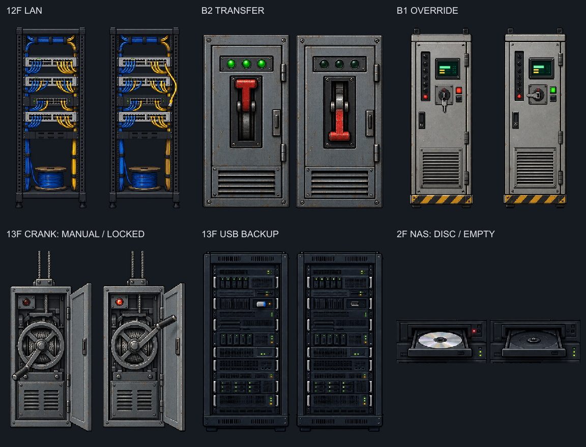

# 퍼즐 소품 상태 스프라이트 · 2026-10-23

내장 `image_gen`으로 제작. 기존 픽셀 아트 참조, 실제 투명 알파. 원본은 각 소품 폴더의 `source/`에 보관한다.



| 대상 | 파일 | 상태 | 연결 |
|---|---|---|---|
| B2 외부 회선 차단반 | `assets/objects/b2/transfer-breaker-states.png` | 0: 레버 위·표시등 ON / 1: 레버 아래·OFF | `b2-transfer-cut` |
| B1 승강기 제어반 | `assets/objects/b1/elevator-override-states.png` | 0: 키 수직·빨강 / 1: 키 수평·초록 | `b1-elevator` |
| 13층 수동 크랭크 | `assets/objects/floor13/manual-crank-states.png` | 0: 정전·수동 가능 / 1: 전원·전자 잠금 | `poweredSprite + selfPowered` |
| 13층 USB 보관함 | `assets/objects/floor13/backup-storage-states.png` | 0: USB 있음 / 1: 빈 슬롯 | `f13-backup-device` |
| 2층 NAS 디스크 트레이 | `assets/objects/floor02/nas-disc-tray-states.png` | 0: 디스크 있음 / 1: 빈 트레이 | `f2-reel` |

일반 시트는 512×512, 가로 두 칸(256×512), 바닥 기준선 y=504. 크랭크는 생성 원본의 좌우를 바꿔 기존 `poweredSprite`의 0=OFF/1=ON 규칙을 따른다. 수동 크랭크는 `selfPowered`로 정전 조작을 보존하며 전자 잠금은 기존 `vaultCrankReady()`가 판정한다.

NAS는 기존 배경의 랙과 조사 위치를 유지한다. 생성 원본 `assets/objects/floor02/source/nas-disc-states.png`에서 디스크 트레이 부분만 잘라 512×128(칸당 256×128) 시트로 내보내고, 기존 NAS 전면에 겹친다. 새 물체나 조사 대상을 추가하지 않는다.

내보내기: alpha > 8 경계를 재고 종횡비 유지·nearest 축소, 프레임별 하단과 중심 정렬. NAS는 랙 경계 기준 x 17%·y 19.5%부터 폭 66%·높이 10.5%의 트레이 영역을 잘라 248×120으로 축소하고 4px 투명 여백을 둔다. 조사 테두리는 `node scripts/build-prop-outlines.mjs`로 재생성한다.

검증: `tests/puzzle-prop-states.mjs`가 5개 소품의 조작 전후, 선행 조건 차단, 전원 복구, 재방문, 저장·불러오기와 프레임 정렬을 확인한다. 수동 조작 입력 자체는 기존 `tests/manual-control.mjs` 담당이다.

이번 실행 결과: `puzzle-prop-states`, `vault-puzzle`, `b2-ending`, `interaction-outline`, `visual-layout`, `scene-assets`, `item-acquisition` 7종 통과. 95개 장면 로딩, 94개 장면 배치, 10종 아이템 획득·데스크톱/모바일 배치를 포함한다. 상태를 준비한 브라우저 자동 검사이며, 새 게임부터 끝까지의 수동 플레이와 실기기 모바일 검증은 수행하지 않았다.

## 최종 생성 프롬프트

### b2-transfer

참조: `assets/objects/floor-kit/electrical-panel.png`. 원본: `assets/objects/b2/source/transfer-breaker-states.png`.

```text
Use case: precise-object-edit. Asset type: transparent production sprite sheet for ARCHI, 2D side-view office mystery game. Match the provided reference's detailed crisp pixel-art, dark graphite and worn steel, restrained cool neutral lighting, realistic proportions. Strict orthographic FRONT view, no perspective. ONE square PNG with EXACTLY TWO equal tall cells SIDE BY SIDE, target 512x512, each frame 256x512. Same object geometry, width, height, alignment, lighting, scratches in both cells; change ONLY the named moving part / indicator. Both objects complete, centered in own half, ample transparent margins, feet/lower edge at identical baseline. TRUE TRANSPARENT alpha outside and inside cutouts, no checkerboard, no ground plane, shadows, background, wall, humans, text, letters, digits, logos, border or watermark. This is game art, not a mockup.
Redesign the provided open electrical breaker cabinet into a CLOSED industrial DR-EXT emergency DISCONNECT cabinet, preserving its narrow gray steel footprint and worn finish. Tall closed steel cabinet with ventilation at base, prominent thick RED mechanical lever in a recessed vertical slot at chest height. LEFT frame: lever clearly UP, three small green link lamps ON. RIGHT frame: exactly same cabinet, lever clearly DOWN, the three green lamps OFF/dark. Large up/down position difference is the main visual. No open door, no tiny bank of ambiguous switches. Isolated cabinet only.
```

### b1-elevator

참조: `assets/objects/floor-kit/elevator-control-panel.png`. 원본: `assets/objects/b1/source/elevator-override-states.png`.

```text
Use case: precise-object-edit. Asset type: transparent production sprite sheet for ARCHI, 2D side-view office mystery game. Match the provided reference's detailed crisp pixel-art, dark graphite and worn steel, restrained cool neutral lighting, realistic proportions. Strict orthographic FRONT view, no perspective. ONE square PNG with EXACTLY TWO equal tall cells SIDE BY SIDE, target 512x512, each frame 256x512. Same object geometry, width, height, alignment, lighting, scratches in both cells; change ONLY the named moving part / indicator. Both objects complete, centered in own half, ample transparent margins, feet/lower edge at identical baseline. TRUE TRANSPARENT alpha outside and inside cutouts, no checkerboard, no ground plane, shadows, background, wall, humans, text, letters, digits, logos, border or watermark. This is game art, not a mockup.
Preserve the provided tall steel elevator control cabinet, hazard striped foot, vent, tiny screen and narrow side row of dark buttons. Make the central mechanical key switch with INSERTED SILVER KEY clearly readable. LEFT frame: key points vertically DOWN (restriction), small square lamp next to it red. RIGHT frame: same inserted key turned 90 degrees CLOCKWISE to horizontal LEFT (manual override released), adjacent square lamp green. Key is never removed. Screen stays dim green in both. Everything else identical. Full cabinet.
```

### f13-crank

참조: `assets/objects/floor-kit/electrical-panel.png`. 원본: `assets/objects/floor13/source/manual-crank-states.png`.

```text
Use case: precise-object-edit. Asset type: transparent production sprite sheet for ARCHI, 2D side-view office mystery game. Match the provided reference's detailed crisp pixel-art, dark graphite and worn steel, restrained cool neutral lighting, realistic proportions. Strict orthographic FRONT view, no perspective. ONE square PNG with EXACTLY TWO equal tall cells SIDE BY SIDE, target 512x512, each frame 256x512. Same object geometry, width, height, alignment, lighting, scratches in both cells; change ONLY the named moving part / indicator. Both objects complete, centered in own half, ample transparent margins, feet/lower edge at identical baseline. TRUE TRANSPARENT alpha outside and inside cutouts, no checkerboard, no ground plane, shadows, background, wall, humans, text, letters, digits, logos, border or watermark. This is game art, not a mockup.
Use the reference ONLY for metal texture, pixel-art and size style. Create a tall narrow wall-mounted MANUAL SHUTTER WINCH cabinet with visible large circular mechanical winding wheel, central horizontal axle, and prominent L-shaped cranking handle. Exposed cable drum with steel wire going UP from the cabinet, mechanical steel body and a vented lower cover. Clearly a manual winch, NOT a generic electrical switchboard. LEFT frame: wheel handle at 2 o'clock resting position, small red electrical-interlock indicator ON. RIGHT frame: same winch, wheel handle rotated to 7 o'clock, red indicator OFF. Preserve all other geometry. The right frame represents manual operation available when power is cut; lighting of metal same in both. No letters or padlock icons. Full narrow cabinet and handle within each half.
```

### f13-usb

참조: `assets/objects/floor-kit/server-rack.png`. 원본: `assets/objects/floor13/source/backup-storage-states.png`.

```text
Use case: precise-object-edit. Asset type: transparent production sprite sheet for ARCHI, 2D side-view office mystery game. Match the provided reference's detailed crisp pixel-art, dark graphite and worn steel, restrained cool neutral lighting, realistic proportions. Strict orthographic FRONT view, no perspective. ONE square PNG with EXACTLY TWO equal tall cells SIDE BY SIDE, target 512x512, each frame 256x512. Same object geometry, width, height, alignment, lighting, scratches in both cells; change ONLY the named moving part / indicator. Both objects complete, centered in own half, ample transparent margins, feet/lower edge at identical baseline. TRUE TRANSPARENT alpha outside and inside cutouts, no checkerboard, no ground plane, shadows, background, wall, humans, text, letters, digits, logos, border or watermark. This is game art, not a mockup.
Preserve the reference tall dark server rack, enclosure, feet, vents and module rows. Make ONE clearly visible backup-storage bay in upper-middle of the rack, with a recessed dark tray and a chunky SMALL SILVER USB BACKUP DRIVE with blue cap inserted into a front-facing USB socket in that bay. The USB drive should be large enough to read at a 190px tall rack. LEFT frame: silver backup USB drive present, its blue cap and metal body visible; small nearby amber LED. RIGHT frame: exact same rack with ONLY that USB drive removed, visibly empty recessed bay and empty USB socket, amber LED OFF. No HDD disk, no cable, no extra rack. Other indicators and geometry identical.
```

### f2-nas

참조: `assets/objects/floor-kit/server-rack.png`. 원본: `assets/objects/floor02/source/nas-disc-states.png`.

```text
Use case: precise-object-edit. Asset type: transparent production sprite sheet for ARCHI, 2D side-view office mystery game. Match the provided reference's detailed crisp pixel-art, dark graphite and worn steel, restrained cool neutral lighting, realistic proportions. Strict orthographic FRONT view, no perspective. ONE square PNG with EXACTLY TWO equal tall cells SIDE BY SIDE, target 512x512, each frame 256x512. Same object geometry, width, height, alignment, lighting, scratches in both cells; change ONLY the named moving part / indicator. Both objects complete, centered in own half, ample transparent margins, feet/lower edge at identical baseline. TRUE TRANSPARENT alpha outside and inside cutouts, no checkerboard, no ground plane, shadows, background, wall, humans, text, letters, digits, logos, border or watermark. This is game art, not a mockup.
Use the provided server rack as art style reference. Create ONE narrow front-facing dark graphite recording NAS rack for a dim office server room. Tall rectangular closed rack with slim charcoal side rails, rows of tiny dim status lights and dark storage modules, no feet extending sideways. A front-loading OPTICAL DISC TRAY near upper-middle is the key feature. LEFT frame: the tray is half ejected toward viewer, with a visibly reflective round silver OPTICAL DISC seated in it, tiny red indicator lit next to tray. RIGHT frame: SAME cabinet, same half-ejected empty tray with circular cradle and center spindle visible, silver disc removed, red indicator off. The disc is a round CD/DVD, NOT a hard drive or cartridge. Keep both tray silhouette and rack identical. Entire tall rack isolated. Dark neutral highlights, no neon, no warning lettering.
```
